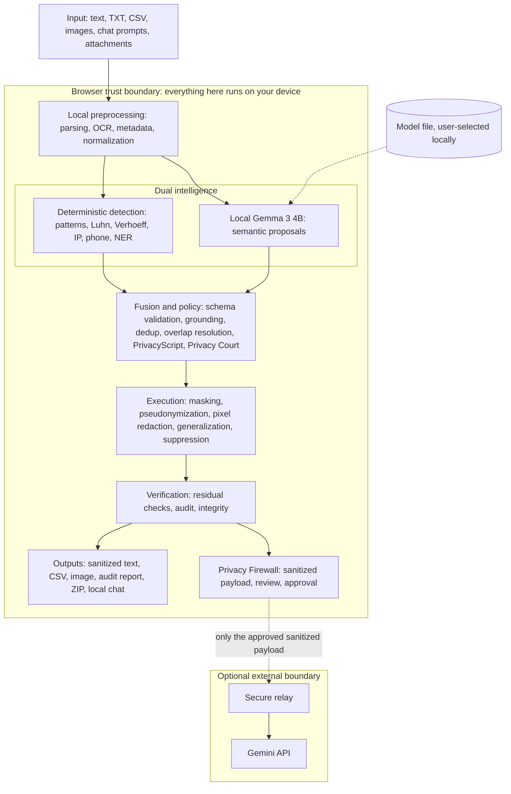
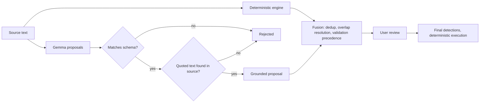
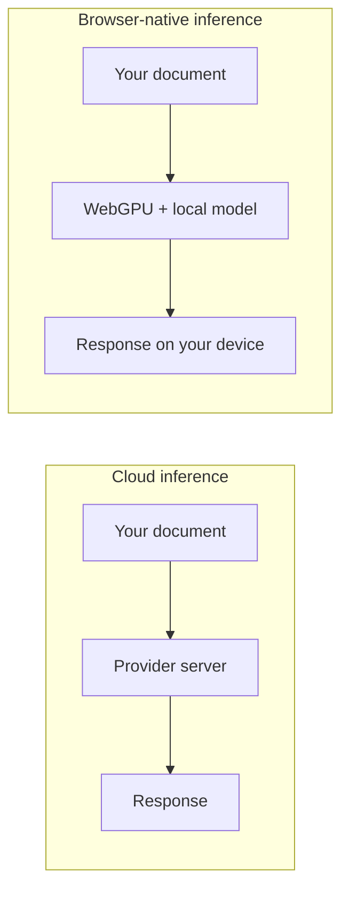
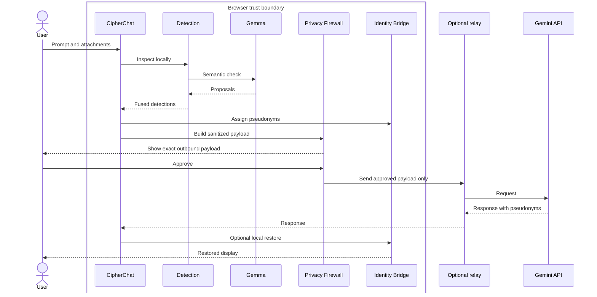
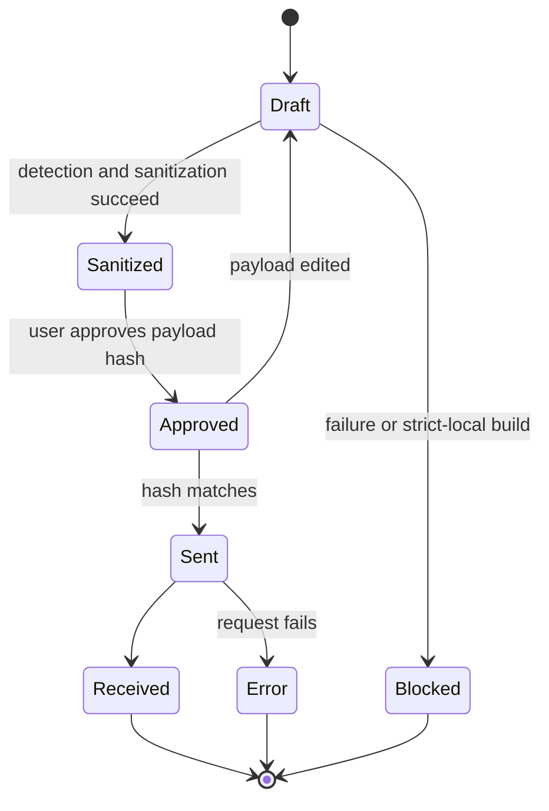
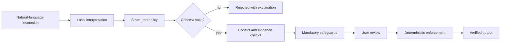
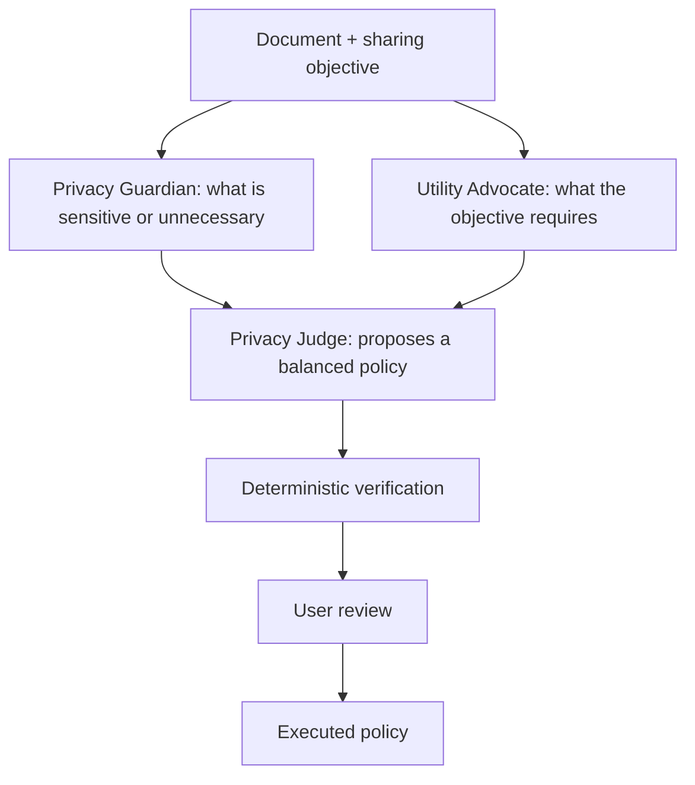
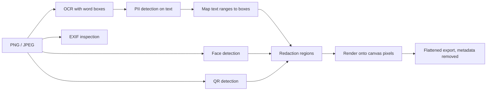
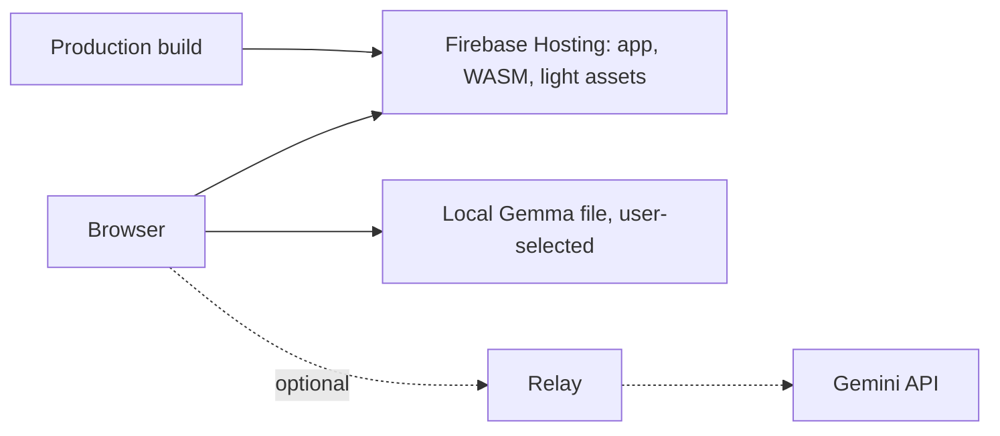

<div align="center">


<br>

**Beyond redaction. Beyond pattern matching.**
CipherMask pairs mathematical privacy validation with browser-native semantic intelligence, so it can tell what information means, why it matters, and whether it needs to be shared at all.

[Architecture](#system-architecture) · [Quick start](#getting-started) · [Prompt log](PROMPT_LOG.md) · [Source](https://github.com/Adnannagariya52/CipherMask)


</div>

---

## 1. The privacy problem, and the CipherMask answer

Imagine an engineer pasting a payment-failure report into an AI assistant:

> Payment failed for Alex Example (alex@example.com), card 4111 1111 1111 1111, from 203.0.113.42. Amount 4,500.00, error code ERR_3DS_TIMEOUT. Alex said the card was used for a dialysis copay.

*(Synthetic data.)* Three things can go wrong:

- A **pattern-based redactor** hides the email and card, but leaves the dialysis sentence. No regular expression recognizes a medical circumstance.
- An **indiscriminate redactor** also removes the amount and the error code, the two details that make the report debuggable.
- An **uncontrolled AI workflow** sends the entire text to a remote service.

CipherMask is built for the gap between these failures. It detects what is sensitive (including context that has no pattern), preserves what the task needs, applies a policy deterministically, verifies the result, and only then lets you decide whether anything leaves the device.

```text
Sanitized: Payment failed for PERSON_01 (EMAIL_01), card [REDACTED], from [REDACTED].
           Amount 4,500.00, error code ERR_3DS_TIMEOUT. PERSON_01 said [SUPPRESSED].
```
*Illustrative output; exact placeholder formats depend on the chosen masking mode.*

**CipherMask is a privacy intelligence layer between confidential information and the outside digital ecosystem.** It is not a single redaction page. It is one workspace for text, images, datasets and AI conversations.

| From | To |
|---|---|
| Pattern matching | Semantic privacy intelligence |
| Manual redaction | Programmable privacy policies |
| Uncontrolled AI interaction | Reviewed, privacy-aware transmission |
| Individual file sanitization | An integrated privacy workspace |

> **The AI proposes. The code decides.** Language-model output is treated as a proposal. Deterministic code validates it, grounds it in the source, and alone executes transformations.

---

## 2. What makes CipherMask different

### 01. Hybrid Privacy Intelligence
Two complementary detection systems run side by side. A **deterministic engine** (patterns, Luhn and Verhoeff checksums, IP and phone parsing, local NER) gives exact, repeatable findings. A **local Gemma 3 4B model** proposes contextual findings such as medical, financial or employment circumstances. Every proposal passes schema validation and exact-source grounding before fusion.
**Benefit:** structured precision plus contextual coverage, without trusting unconstrained model output.

### 02. PrivacyScript
Plain-language requirements become a validated, structured privacy policy. The model produces **policy data, never executable code**; deterministic logic enforces it.
**Benefit:** people who know nothing about regex can express exactly what to hide, keep or pseudonymize.

### 03. Privacy Court
A staged decision process that balances confidentiality against utility with three logical roles (Guardian, Advocate, Judge), followed by deterministic verification. All roles use the **same local model**; they are prompts, not separate trained experts.
**Benefit:** the decision documents both what to hide and what must stay.

### 04. CipherChat and Identity Bridge
A privacy-aware way to use AI. Prompts are inspected and sanitized locally; in the optional cloud mode you review the exact outbound payload before it is sent; consistent pseudonyms let the external model keep relationships straight, and approved values can be restored **locally** in the response.
**Benefit:** useful AI help with less unnecessary exposure.

### Architectural comparison

An architectural comparison, not a measured ranking of products. "Depends" means the capability is possible but not inherent to the approach.

| Capability | Pattern-only redaction | Standalone LLM analysis | Manual preparation | **CipherMask** |
|---|---|---|---|---|
| Structured identifier detection | Inherent | Depends | Depends | Yes |
| Checksum validation (Luhn, Verhoeff) | Depends | Not inherent | Not inherent | Yes |
| Contextual sensitivity | Not inherent | Inherent | Inherent | Yes (local model) |
| Exact-source evidence grounding | Inherent (positions) | Not inherent | Not applicable | Yes |
| Deterministic execution | Inherent | Not inherent | Not applicable | Yes |
| Natural-language policies | Not inherent | Depends | Not applicable | Yes |
| Purpose-aware decisions | Not inherent | Depends | Inherent | Yes |
| Image and dataset handling | Depends | Depends | Inherent | Yes |
| Outbound payload review | Not inherent | Not inherent | Depends | Yes |
| Local identity restoration | Not inherent | Not inherent | Not applicable | Yes |
| Post-transformation verification | Not inherent | Not inherent | Depends | Yes |

---

## 3. See CipherMask in action

The synthetic report from section 1 flows through the workspace like this:

| Step | What happens |
|---|---|
| 1. Input | The text is pasted or loaded as a file. |
| 2. Deterministic detection | Email, card (Luhn-valid) and IP are found with exact positions. |
| 3. Local NER | The person name is found. |
| 4. Semantic detection | Gemma proposes the dialysis sentence; its quoted text is matched against the source. |
| 5. Fusion | Duplicates are merged, overlaps resolved, mandatory validated findings keep precedence. |
| 6. Policy | Amount and error code are preserved; the rest is masked, pseudonymized or suppressed. |
| 7. Review | You see original and sanitized text side by side, with entity counts. |
| 8. Verification | The output is rescanned for residual identifiers. |
| 9. Export | Sanitized text is downloaded, or passed to CipherChat. |

<details>
<summary><b>Illustrative detection record</b> (simplified; not the exact schema)</summary>

| Span | Category | Source | Validation | Decision |
|---|---|---|---|---|
| alex@example.com | EMAIL | deterministic | format check | pseudonymize |
| 4111 1111 1111 1111 | CREDIT_CARD | deterministic | Luhn passed | mask |
| 203.0.113.42 | IP | deterministic | structural parse | mask |
| Alex / Alex Example | PERSON | local NER | n/a | pseudonymize |
| "the card was used for a dialysis copay" | MEDICAL_CONTEXT | Gemma (AI-only) | quote found in source | suppress |
| 4,500.00 / ERR_3DS_TIMEOUT | AMOUNT / ERROR_CODE | policy | n/a | preserve |
</details>

---

## 4. Features and challenge coverage

CipherMask began as a browser-based sanitization challenge for the **PromptWars Hackathon** and grew into a larger workspace.

### Challenge requirements

| Requirement | CipherMask capability |
|---|---|
| Paste text; upload TXT and CSV | Text Shield (text, TXT) and Data Shield (CSV) |
| Client-side sanitization, no raw-document transmission during the mandatory workflow | Sanitization runs in the browser; a strict-local build blocks cloud features entirely |
| Detect email, phone, IP, PAN, Aadhaar, credit card | Pattern detection with structural validation |
| Luhn validation for cards | Luhn checksum; Verhoeff for Aadhaar candidates |
| Full masking, partial masking, consistent pseudonymization | Three selectable modes |
| Live side-by-side comparison and entity counts | Original and sanitized views with per-category counts |
| Sanitized downloads and one-click noisy sample | Export plus a sample loader |
| Development prompt log | [`PROMPT_LOG.md`](PROMPT_LOG.md) |

### Beyond the challenge

| Group | Capabilities |
|---|---|
| **Core workspace** | Text Shield, Vision Shield (OCR, face and QR detection, EXIF handling, pixel-level redaction), Data Shield (CSV privacy analysis) |
| **AI layer** | Local Gemma inference, Semantic Shield, hybrid detection, PrivacyScript, purpose-aware privacy, Privacy Court |
| **Protected AI interaction** | Local CipherChat, optional protected Gemini chat, Identity Bridge, Privacy Firewall, sanitized attachment handling |
| **Verification and protection** | Leak Hunter and residual scanning, cross-document consistency, encrypted Identity Vault, audit reports, collection ZIP export, Benchmark Laboratory, Privacy Center |
| **Infrastructure** | Browser-native execution, WebGPU diagnostics, local model provisioning, strict-local and cloud build profiles, Firebase Hosting |

> Gemini cloud assistance is **optional** and separate from the mandatory local sanitization workflow.

---

## 5. System architecture



- **Inside the browser:** detection, OCR, image processing, data analysis, Gemma inference, policy execution and verification.
- **Static hosting:** Firebase Hosting serves the application and lightweight runtime assets only. It does not process documents and does not run Gemma.
- **Model weights:** never hosted on Firebase or committed to GitHub; each user selects the file locally.
- **Outside the browser (optional):** only a sanitized, user-approved payload can reach the relay and Gemini.

---

## 6. Local AI and hybrid privacy intelligence

### Why two engines

| | Deterministic engine | Local semantic engine |
|---|---|---|
| Strengths | Repeatable, exact positions, mathematical validation, efficient | Context, indirect disclosure, purpose awareness |
| Weaknesses | Blind to meaning | Can hallucinate, miss items, or misjudge sensitivity |
| Role | Authority for structured identifiers | Proposer of additional findings |

### Fusion and enforcement



Five checks matter, and they are not the same thing:

| Check | Question it answers | Guarantees |
|---|---|---|
| Syntactic validity | Is the output well-formed per schema? | Structure only |
| Source grounding | Does the quoted text actually exist in the source? | No invented text. Positions come from matching, not from the model's character offsets |
| Semantic correctness | Is it truly sensitive? | **Not guaranteed**; this is a model judgment |
| Policy relevance | Does it matter for the stated purpose? | Depends on the policy |
| User approval | Does the person agree? | Final human check |

Grounding proves a proposal *exists* in the source, not that the model's classification is *right*. That is why mandatory validated detections (a Luhn-valid card, for example) cannot be silently overridden by AI, and why proposals remain reviewable.

**Examples (illustrative):** a grounded AI-only finding is the dialysis sentence above. A rejected proposal is one whose quoted text does not appear verbatim in the source, so it is dropped. A duplicate is an AI finding that overlaps an existing deterministic span; it merges rather than double-counting.

### Gemma 3 4B in the browser

| Item | Detail |
|---|---|
| Model | Gemma 3 4B Instruct, INT4 quantized |
| File | `gemma3-4b-it-int4-web.task` |
| Source | [litert-community/Gemma3-4B-IT](https://huggingface.co/litert-community/Gemma3-4B-IT) |
| Runtime | MediaPipe LLM Inference |
| Acceleration | WebGPU |

*Parameters* are the learned weights (about four billion). *INT4 quantization* stores weights in 4 bits, cutting file size and memory at some potential cost in fidelity. *WebGPU* gives the browser access to GPU compute.



Readiness has distinct levels: model asset verified, runtime initialized, and real inference producing output. The model needs compatible hardware and a browser with WebGPU; basic sanitization does not depend on it.

---

## 7. CipherChat, Identity Bridge and Privacy Firewall

### CipherChat

| Mode | Engine | What leaves the browser |
|---|---|---|
| **Private** | Local Gemma | No external inference |
| **Protected cloud (optional)** | Gemini through a relay | Only the sanitized payload you approved |

> Cloud mode is **not** equivalent to private or offline inference. Remaining context may still be sensitive.



### Identity Bridge

Removing identifiers can make an AI answer less useful. Consistent pseudonyms let the external model reason about relationships without receiving the originals.

| Representation | Example (synthetic) |
|---|---|
| 1. Original local input | Write an apology email to Alex Example at alex@example.com about a failed payment. |
| 2. Sanitized outbound | Write an apology email to PERSON_01 at EMAIL_01 about a failed payment. |
| 3. External response | Dear PERSON_01, we sincerely apologize for the inconvenience. |
| 4. Restored, local display only | Dear Alex Example, we sincerely apologize for the inconvenience. |

Mappings are session-scoped and stable; restored text is display-only and is **never** added to the history sent in later requests. Pseudonymization is reversible when a mapping exists, so it is not anonymization.

### Privacy Firewall

An **application-level** controlled request pipeline, not an operating-system firewall. Its intent: build the outbound payload independently from sanitized content, validate it, require explicit approval bound to the exact payload (a SHA-256 fingerprint, which provides integrity rather than confidentiality), invalidate approval if the payload changes, exclude original documents and identity mappings, block cloud entirely in the strict-local build, and fail closed on errors.



The firewall cannot prove that every sensitive fact was removed; review remains part of the design.

---

## 8. Multimodal processing and technical foundations

### PrivacyScript



*"Hide contact information and medical circumstances, replace personal names with consistent pseudonyms, and preserve transaction amounts and technical error codes."*

<details>
<summary><b>Illustrative policy</b> (simplified; one action per category)</summary>

```json
{
  "rules": [
    { "category": "EMAIL",           "action": "mask" },
    { "category": "PHONE",           "action": "mask" },
    { "category": "MEDICAL_CONTEXT", "action": "suppress" },
    { "category": "PERSON",          "action": "pseudonymize" },
    { "category": "AMOUNT",          "action": "preserve" },
    { "category": "ERROR_CODE",      "action": "preserve" }
  ]
}
```
A category is assigned a single action, so the policy is unambiguous. Contradictory or unsupported requests are rejected at validation rather than guessed at.
</details>

### Purpose-aware privacy

The right sanitization depends on why the document is shared. Using the synthetic report:

| Fact | Technical debugging | Transaction analysis | Healthcare research |
|---|---|---|---|
| Customer name | Pseudonym | Pseudonym | Suppress |
| Card number | Mask | Suppress | Suppress |
| Error code | **Keep** | Keep | Mask |
| Amount | **Keep** | **Keep** | Generalize |
| Medical circumstance | Suppress | Suppress | **Keep, generalized** |

Over-masking destroys utility; under-masking is unnecessary disclosure. Recommendations are constrained by deterministic safeguards and do not make the result safe for every recipient.

### Privacy Court



The diagram shows data dependencies: the Judge consumes both recommendations, and deterministic code has the final word. The interface shows concise decision explanations, not hidden model reasoning.

### Vision Shield



OCR returns words with bounding boxes; each word corresponds to a character range in the extracted text. A grounded detection over a text range selects the overlapping words, and their boxes become the region. The model never invents coordinates. Semantic analysis is **OCR-assisted**; Gemma is not used as a direct image model. Redactions are rendered into real pixels, not removable overlays. Blur and pixelation can be weaker than opaque fill, which is the stronger choice.

### Data Shield

Direct identifiers (email, ID number) identify a person alone; quasi-identifiers (age, location, occupation) can single someone out in combination. For quasi-identifier set $Q$, records sharing identical $Q$ values form an equivalence class, and the dataset is $k$-anonymous over $Q$ when

$$\min_{c \in \mathcal{C}(D,Q)} |c| \ge k$$

Synthetic example, $Q = \{\text{age},\ \text{ZIP},\ \text{occupation}\}$:

| Age | ZIP | Occupation | | Age | ZIP | Occupation |
|---|---|---|---|---|---|---|
| 34 | 411001 | Cardiologist | → | 30-39 | 4110** | Physician |
| 36 | 411002 | Cardiologist | → | 30-39 | 4110** | Physician |
| 35 | 411001 | Cardiologist | → | 30-39 | 4110** | Physician |
| 58 | 411045 | Teacher | → | 50-69 | 4110** | Educator |
| 61 | 411045 | Teacher | → | 50-69 | 4110** | Educator |
| 59 | 411046 | Teacher | → | 50-69 | 4110** | Educator |

Before: every record is unique, so the minimum class size is 1 (six singletons). After generalization: two classes of three records, so the minimum class size is 3 and the data is 3-anonymous over $Q$. The cost is utility (wide age bands, coarse ZIPs). $k$-anonymity does not stop attribute inference or linkage with outside data.

### Validation algorithms

- **Luhn:** from the right, double every second digit, subtract 9 from results above 9, sum; valid if the sum is divisible by 10. It shows a plausible number, not a real account.
- **Verhoeff:** a checksum built on the dihedral group $D_5$ using multiplication, permutation and inverse tables; it catches all single-digit errors and most adjacent transpositions, and screens Aadhaar candidates. It does not verify identity.
- **PAN:** structural format check, not a government lookup.
- **Overlap resolution:** spans $[s_1,e_1)$ and $[s_2,e_2)$ overlap iff $s_1 < e_2 \land s_2 < e_1$; overlapping detections are merged or ranked, with validated mandatory findings taking precedence.
- **Evaluation metrics:** $P=\frac{TP}{TP+FP}$, $R=\frac{TP}{TP+FN}$, $F_1=\frac{2PR}{P+R}$.

### Verification and the Identity Vault

Redaction and verification are separate stages because a transformation can succeed and still leave something behind. Output is rescanned for residual identifiers, original values and obfuscated forms (with offsets preserved through normalization), and results are reported as passed, review required, failed, not tested or unavailable. **No output is labeled universally safe.** Reversible identity mappings are sensitive, so the encrypted Identity Vault stores them under a user password using the browser's Web Crypto API, kept separate from sanitized exports. Encryption is not hashing, masking or anonymization, and it cannot defend a compromised device or malicious browser extension.

---

## 9. Benchmarks, verification and security

### Evaluation approach

Benchmark Laboratory is designed to measure precision, recall, F1, false positives and negatives, exact-span matching, grounded versus rejected AI proposals, AI-only findings and inference latency on a synthetic labeled corpus, separating structured-identifier performance from semantic-sensitivity performance. Reported deterministic-versus-hybrid comparisons should be read as results on a small synthetic corpus, not as production accuracy.

### Verification

Verification is organized by what each test layer can honestly show:

| Layer | What it demonstrates |
|---|---|
| Deterministic unit tests | Validators, fusion, pseudonym stability, policy validation |
| Mocked-inference tests | Grounding rejection and fusion logic without a GPU |
| Browser end-to-end tests | Workflows, strict-local blocking, network inspection |
| Real-model tests | Actual Gemma inference on supported hardware |
| Build profiles | Strict-local and cloud builds |

Security-focused cases include hallucinated-quote rejection, duplicate fusion, mandatory-validation precedence, invalid-policy rejection, stale-approval blocking, raw-sentinel exclusion from outbound payloads, strict-cloud blocking and restoration separation.

### Threat model

| Threat | Design response |
|---|---|
| Accidental raw transmission | Local-first processing; strict-local build; explicit approval; fail-closed firewall |
| Model hallucination | Schema validation; exact-source grounding; deterministic enforcement |
| Missed detections | Hybrid engines; residual scan; user review |
| Prompt injection inside documents | Model emits structured data only; no generated code is executed |
| Stale approval | Approval bound to a payload fingerprint |
| Identity mapping leakage | Mappings excluded from exports and requests; optional encrypted vault |
| Credential exposure | Gemini key held server-side only; never in frontend variables |
| Metadata exposure | EXIF inspection and removal |
| Indirect re-identification | Dataset indicators; $k$-anonymity with stated limits |
| Compromised browser | Out of scope |

Protected assets include original documents, prompts, images, CSV records, identity mappings, passwords, API credentials and conversation history. Trust boundaries are the browser, the local runtime, static hosting, the optional relay and the external AI provider.

---

## 10. Technology stack and input/output matrix

| Area | Technologies | Why |
|---|---|---|
| Frontend | React, TypeScript, Vite | Typed, componentized UI and fast builds |
| Local AI | Gemma 3 4B, MediaPipe LLM Inference, WebGPU, WebAssembly | On-device inference |
| Vision | Tesseract.js, MediaPipe Tasks Vision, Canvas, jsQR, exifr | OCR, faces, QR codes, metadata, pixel rendering |
| Data | Papa Parse | Robust CSV parsing (quotes, multiline cells) |
| Validation and crypto | Zod, Web Crypto API | Schema validation, hashing, vault encryption |
| Export | JSZip | Collection ZIP |
| Cloud (optional) | Firebase Hosting, relay, Gemini API | Static hosting and sanitized-only API access |
| Quality | Vitest, Playwright, ESLint, TypeScript | Unit, browser and static checks |

| Module | Input | Output | Runs | External transmission |
|---|---|---|---|---|
| Text Shield | Text, TXT | Sanitized text, counts | Browser | None |
| Vision Shield | PNG, JPEG | Flattened sanitized image | Browser | None |
| Data Shield | CSV | Sanitized CSV, privacy indicators | Browser | None |
| PrivacyScript | Instruction | Validated policy | Browser | None |
| Privacy Court | Document, objective | Policy recommendations | Browser | None |
| Local CipherChat | Prompt, context | Local response | Browser | None |
| Protected CipherChat | Approved sanitized payload | Gemini response | Browser, relay | Sanitized payload only |
| Identity Bridge | Pseudonyms, mappings | Restored display text | Browser | None |
| Identity Vault | Mappings, password | Encrypted mapping artifact | Browser | None |
| Audit, collection export | Sanitized files | Reports, ZIP | Browser | None |

---

## 11. Getting started

**Prerequisites:** Node.js, npm, Git and a modern browser. Local AI additionally needs a WebGPU-capable GPU.

```bash
git clone https://github.com/Adnannagariya52/CipherMask.git
cd CipherMask
npm ci
npm run setup:assets
npm run setup:models
npm run dev
```

Basic sanitization needs no model and no credentials. Browser OCR, Vision, NER, and GenAI runtime binaries are intentionally excluded from the source submission to keep it below the 10 MB submission limit; the two setup commands above restore them locally from pinned packages and documented sources. Gemma weights remain excluded and must be supplied separately as described below.

### Enable local Gemma (optional)

Model weights are excluded from GitHub and Firebase because of their size and license terms.

1. Open [litert-community/Gemma3-4B-IT](https://huggingface.co/litert-community/Gemma3-4B-IT) and accept the terms.
2. Download `gemma3-4b-it-int4-web.task`, via the website or:

```bash
hf auth login
hf download litert-community/Gemma3-4B-IT gemma3-4b-it-int4-web.task --local-dir public/models
```

3. In the app, open the **Local AI & Cloud** panel and select the local model file. It is read on your device and never uploaded.

### Optional Gemini

Cloud chat uses a server-side relay so the API key never reaches the browser. Use placeholders in an ignored environment file or a secret store, never in `VITE_` variables:

```bash
GEMINI_API_KEY=YOUR_API_KEY
GEMINI_MODEL_ID=YOUR_SUPPORTED_MODEL
ENABLE_CLOUD_CHAT=true
```

### Builds and checks

```bash
npm run build:strict   # cloud features blocked
npm run build:cloud    # optional cloud chat enabled
npm run typecheck
npm run lint
npm run verify
npm run test:e2e
```

**Troubleshooting:** if the model will not initialize, confirm WebGPU is available in your browser and the file is the INT4 `.task` build; if OCR or vision assets are missing, run the asset verification scripts from `package.json`.

---

## 12. Engineering, deployment and development history



Firebase Hosting serves static files; privacy processing and Gemma inference happen in the browser, so no document database is needed. Updates are deployed to the same Hosting site.

**Evolution:** foundational PII sanitization, then mathematical validation, multimodal processing, local NER, dataset privacy, local Gemma reasoning, hybrid detection, PrivacyScript, Privacy Court, CipherChat, Identity Bridge, the outbound firewall, Firebase deployment and UI refinement. Each stage extended the same principle: let AI widen what can be found, and let code keep authority over what is done.

**AI-assisted development:** CipherMask was built with AI development assistance (Antigravity); the full prompt history is in [`PROMPT_LOG.md`](PROMPT_LOG.md).

---

## 13. Limitations and responsible use

- **Hardware:** the local model is large, takes time to initialize and needs WebGPU-capable hardware.
- **Detection:** semantic detection is imperfect, OCR can miss text, and context windows limit very long documents. Mitigations are hybrid detection, grounding and review.
- **Images:** blur and pixelation are weaker than opaque redaction.
- **Datasets:** $k$-anonymity is not a proof of anonymity.
- **Cloud:** the optional mode adds residual risk even after sanitization.
- **Environment:** a compromised browser sits outside the security model.
- **Responsibility:** CipherMask provides privacy engineering tools and checks, not a guarantee of anonymity or legal compliance, and it is not certified for regulated use.

## 14. Roadmap, credits and license

**Future work (not yet implemented):** more document formats, multilingual detection, more efficient browser models, stronger privacy optimization, richer evaluation, organization-level policies and browser integration.

**Maintained by** [@Adnannagariya52](https://github.com/Adnannagariya52).

**Built on** Google Gemma and AI Edge, MediaPipe, Tesseract.js, React, Firebase and the wider open-source privacy community. Third-party libraries and the Gemma model are governed by their own licenses, and Gemma use is subject to its published terms.

<div align="center">

**Share the information. Not the identity.**

</div>
