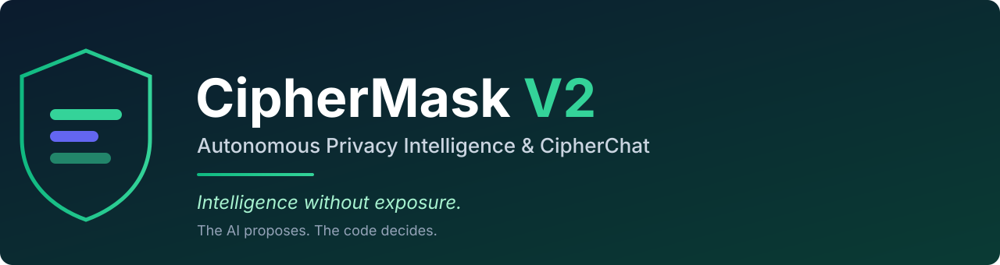
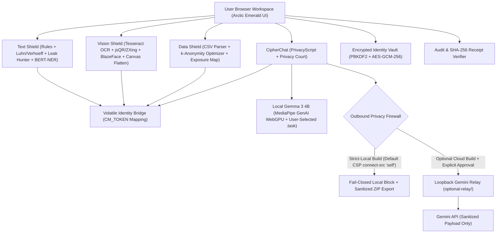
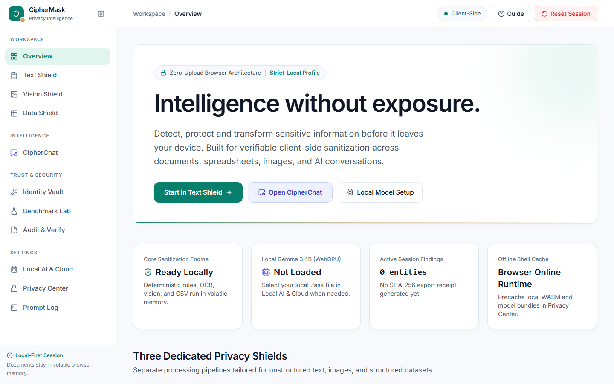
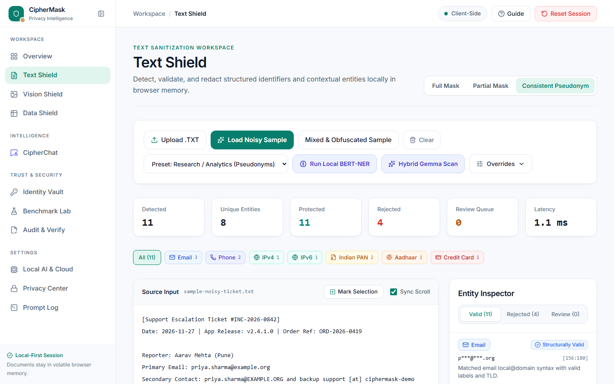
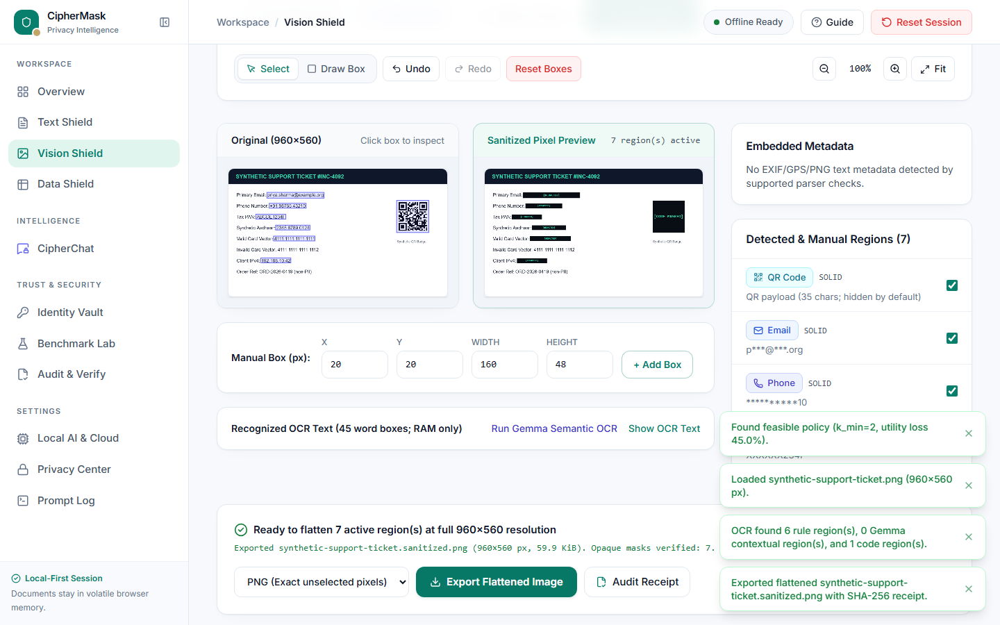
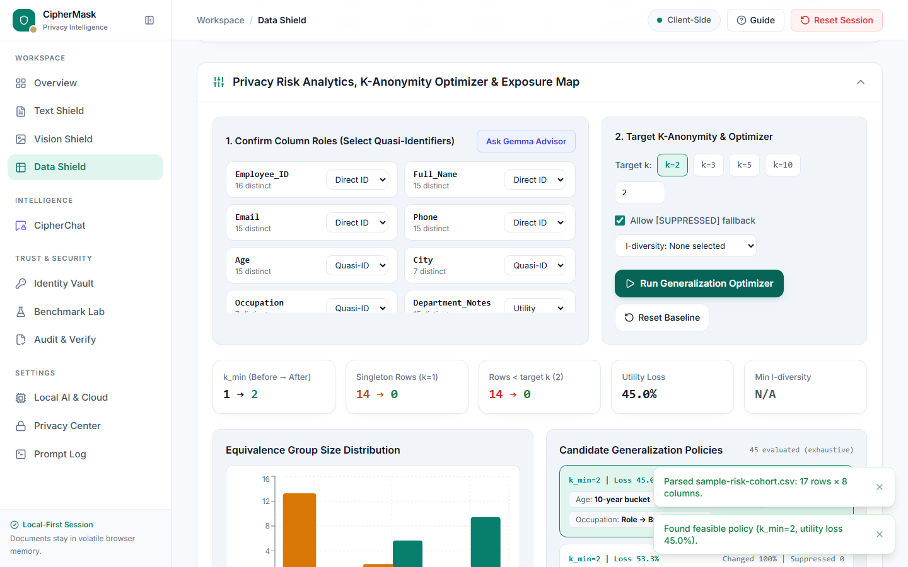
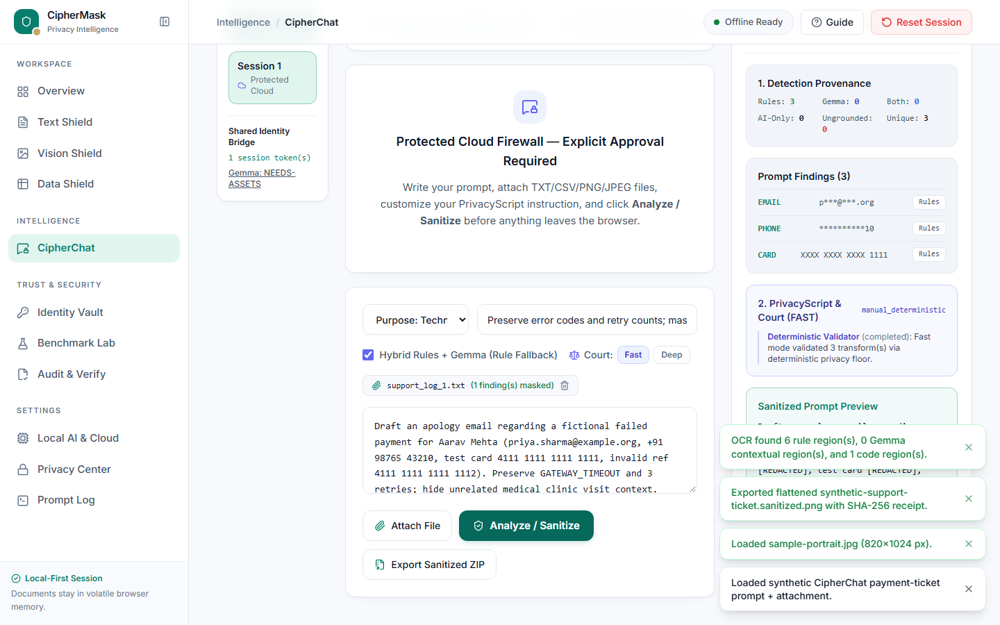
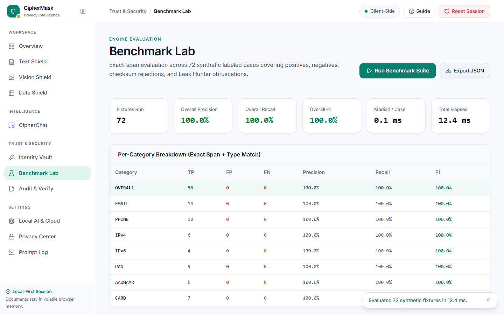
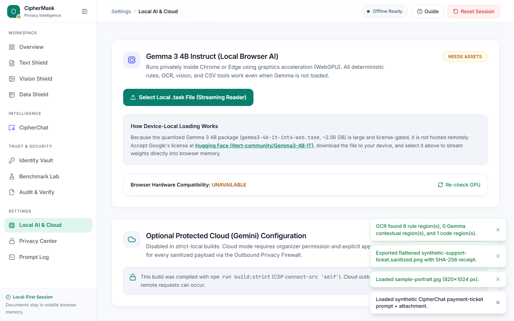
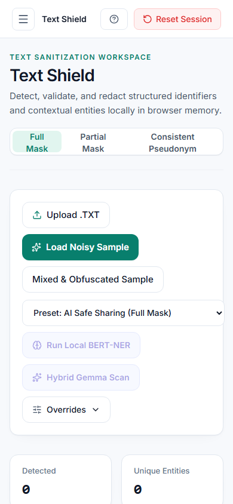

# CipherMask V2 — Autonomous Privacy Intelligence & CipherChat

<p align="center">
  
</p>

**Tagline:** *Intelligence without exposure. Share the information, not the identity.*

- **Live Web App (Firebase Hosting):** https://ciphermask-94dbd.web.app
- **Source Repository:** https://github.com/Adnannagariya52/CipherMask
- **Documentation:** [ARCHITECTURE.md](ARCHITECTURE.md) · [SECURITY.md](SECURITY.md) · [MODEL_ASSETS.md](MODEL_ASSETS.md) · [DEMO.md](DEMO.md) · [BUILD_STATUS.md](BUILD_STATUS.md) · [PROMPT_LOG.md](PROMPT_LOG.md) · [TEST_REPORT.md](docs/TEST_REPORT.md)

CipherMask V2 is a client-side, static single-page React + TypeScript multimodal privacy preparation workspace combining deterministic PII detection/validation, computer vision pixel sanitization, CSV `k`-anonymity optimization, and **CipherChat**—a trust-separated AI workspace pairing browser-native **Gemma 3 4B Instruct (WebGPU)** reasoning with **PrivacyScript**, **Privacy Court**, a shared **Identity Bridge**, and an explicit fail-closed **Outbound Privacy Firewall** for optional cloud Gemini usage.

---

## System Architecture



---

## Visual Walkthrough (`docs/screenshots/`)

| Workspace Overview | Text Shield |
| --- | --- |
|  |  |

| Vision Shield | Data Shield |
| --- | --- |
|  |  |

| CipherChat & Firewall | Benchmark Laboratory |
| --- | --- |
|  |  |

| Local AI & Gemma Setup | Responsive Mobile Shell |
| --- | --- |
|  |  |

---

## Prerequisites

- **Node.js**: v22.12+ recommended (verified on `v24.16.0` / `npm 11.13.0`)
- **Browser**: Current desktop Chrome / Edge with WebGPU hardware acceleration (verified on Playwright Chromium `159.0.8154.6`)
- **Optional Local Gemma 3 4B Weights**: Gated repository [`litert-community/Gemma3-4B-IT`](https://huggingface.co/litert-community/Gemma3-4B-IT) (`gemma3-4b-it-int4-web.task`, ~2.56 GB). Excluded from Git & Firebase Hosting; accept Google's license on Hugging Face, download locally, and select via **Local AI & Cloud → Select Local .task File (Streaming Reader)**.
- **Optional ONNX NER Weights Note**: `public/assets/ner/models/Xenova/bert-base-NER/onnx/model_quantized.onnx` (~103.9 MiB) exceeds GitHub's 100 MiB file limit and is excluded via `.gitignore`. Run `npm run setup:assets` after cloning to restore and SHA-256 verify all local ML assets.

---

## Quick Start & Commands

```bash
# 1. Install pinned dependencies
npm ci

# 2. Provision and verify local OCR, MediaPipe Vision, ONNX-NER, and GenAI WASM assets
npm run setup:assets
npm run verify:assets
npm run setup:models
npm run verify:models

# 3. Development server
npm run dev

# 4. Strict-local production build (default; CSP connect-src 'self', cloud disabled)
npm run build:strict
npm run preview

# 5. Optional cloud-enabled build + loopback relay (requires organizer permission & key)
npm run build:cloud
npm run cloud:relay

# 6. Full verification & tests
npm run verify
npm run test:e2e
npm run test:privacy
```

---

## Implemented Capabilities

### 1. Text Shield (`src/features/text/TextShield.tsx`, `src/engine/`)
- **Mandatory & Structured PII**: Email, Phone (`libphonenumber-js` IN default + international), IPv4/IPv6 (`ipaddr.js`, rejecting invalid octets like `999.168.1.100` and version strings), Indian PAN, Aadhaar (12 digits starting 2–9 + Verhoeff checksum), Credit Card (13–19 digits + Luhn mod-10 validation).
- **Three Redaction Modes + Presets**: `Full Mask` (`[REDACTED]`), `Partial Mask` (e.g. `XXXX XXXX XXXX 1111`), and `Consistent Pseudonym` (`EMAIL_01`, `PAN_01`, etc., consistent across normalized repeats and collision-safe against preexisting literal tokens).
- **Leak Hunter**: Unicode-safe normalization pass catching zero-width chars, fullwidth digits/symbols, Devanagari/Arabic-Indic digits, and `[at]`/`(at)`/`[dot]`/`(dot)` email obfuscations with exact UTF-16 offset mapping, plus secondary post-redaction output verification.
- **Optional Local BERT-NER**: Lazy-loaded `Xenova/bert-base-NER` (`model_quantized.onnx` via `@huggingface/transformers` + local ONNX WASM) in a Web Worker (`env.allowRemoteModels = false`) proposing `PERSON` / `LOCATION` / `ORGANIZATION` candidates for review.

### 2. Vision Shield (`src/features/vision/VisionShield.tsx`, `src/engine/vision/`)
- **Canonical Orientation & Canvas Rendering**: Validates PNG/JPEG magic bytes (15 MiB / 16 MP bounds), normalizes EXIF orientation once, renders weaker effects (`blur` with CPU fallback, `pixelate`) before opaque solid masks so overlaps never restore hidden pixels, and exports flattened PNG/JPEG files with zero editable layers.
- **Local OCR & Code Detection**: `tesseract.js` v7 (`eng.traineddata.gz`, `workerBlobURL: false`, `cacheMethod: 'none'`) maps detected PII spans back to word/line bounding boxes; multi-pass `jsQR` + `@zxing/library` detect QR codes and barcodes.
- **Local Face & Person Detection**: `@mediapipe/tasks-vision` `FaceDetector` (`blaze_face_short_range.tflite`, CPU) with per-face toggles, plus optional `ImageSegmenter` (`selfie_segmenter.tflite`, all-foreground person mask), manual rectangle drawing + keyboard numeric box entry, undo/redo, and `exifr` + PNG chunk metadata inspection/removal verification.

### 3. Data Shield & Identity Exposure Map (`src/features/data/`)
- **CSV Engine**: Papa Parse (`dynamicTyping: false` preserving leading zeros, quoted commas, multiline cells, duplicate headers), formula-prefix detection (`=`, `+`, `-`, `@`) with optional spreadsheet-safe escaping, and consistent per-cell pseudonymization across rows.
- **K-Anonymity & Generalization Optimizer**: Real equivalence-class risk assessment (`k_min`, singleton rows, rows below target `k`, optional `l-diversity`) and Web Worker policy search across age buckets, ISO dates, and bundled sample geography/occupation hierarchies—ranked by transparent weighted normalized utility loss, plus Recharts distribution chart and SVG/table **Identity Exposure Map**.

### 4. CipherChat, Hybrid Gemma AI & Privacy Firewall (`src/chat/`, `src/intelligence/`, `src/gateway/`)
- **Hybrid Rules + Gemma Detection (`src/intelligence/fusion.ts`, `semanticDetector.ts`)**: Combines deterministic rules with local **Gemma 3 4B Instruct (WebGPU)** semantic analysis via `@mediapipe/tasks-genai` (`src/intelligence/localReasoner.ts`), grounding quotes back to exact offsets with strict `Rules` / `Gemma` / `Both` provenance.
- **PrivacyScript & Privacy Court (`policyCompiler.ts`, `privacyCourt.ts`)**: Compiles natural-language user privacy intents under an explicit non-negotiable PII floor and audits transformations in Fast or Deep mode.
- **Shared Identity Bridge & Outbound Firewall (`src/workspace/identityBridge.ts`, `src/gateway/firewall.ts`)**: Maps `[[CM_...]]` tokens across attached documents and prompts, inspects outbound payloads in an explicit fail-closed approval flow (`prepareRelease` / `approveRelease` / `sendApproved`), supports sanitized ZIP exports (`JSZip`), and pairs optionally with the loopback Gemini relay (`optional-relay/`).

### 5. Audit, Vault, Benchmark Lab, Privacy Center & Prompt Log
- **Audit & Receipt Checker (`src/features/audit/`)**: Computes exact-byte `SHA-256` digests (`crypto.subtle.digest`) without storing raw PII, filenames, or GPS; verifies uploaded sanitized files against `.json` receipts locally.
- **Encrypted Identity Vault (`src/features/vault/`)**: Optional reversible storage for pseudonymized TXT/CSV using `PBKDF2-HMAC-SHA256` (600,000 iterations) + `AES-GCM-256` with authenticated header metadata and pre-restoration SHA-256 verification.
- **Benchmark Lab (`src/features/benchmark/`)**: Evaluates 72 independent synthetic labeled cases in-browser with exact span+type TP/FP/FN metrics.
- **Offline Service Worker (`public/sw.js`)**: Versioned allowlist precaching for static shell and `/assets/` models via **Privacy Center**.

---

## Verified Build & Test Evidence

- **Asset Verification (`npm run verify:assets`)**: 37/37 manifest entries verified (`ocr`: 20 files / 45.15 MiB, `vision`: 7 files / 29.24 MiB, `ner`: 10 files / 144.04 MiB).
- **GenAI Runtime Check (`npm run verify:models`)**: 6/6 `@mediapipe/tasks-genai` WASM files verified.
- **Unit Suite (`npm test` / Vitest)**: 7 test files, 26/26 tests passed.
- **TypeScript & ESLint (`npm run verify`)**: `tsc --noEmit` 0 errors, `eslint .` 0 errors (2 pre-existing fast-refresh warnings).
- **Synthetic Benchmark (`runSyntheticBenchmark`)**: 72 synthetic fixtures, 56 TP, 0 FP, 0 FN (12 rejected candidates tracked separately), median 0.186 ms/case. *(Self-created synthetic benchmark; does not establish real-world generalization.)*
- **Playwright E2E (`npm run test:e2e` on `dist/` preview)**: 5/5 suites passed on Chromium covering Text Shield + zero external network sentinel proof, Data Shield + k-anonymity optimizer, Vision Shield real OCR + jsQR + BlazeFace + PNG export, Benchmark Lab, Audit Receipt Checker, Prompt Log, offline Service Worker reload, and CipherChat strict-local firewall enforcement.
- **Live Firebase Hosting Verification (`https://ciphermask-94dbd.web.app`)**: Verified HTTP `200` on `/` and SPA deep-links (`/vault`), strict CSP `connect-src 'self'`, WASM/gzip asset MIME types, `0` leaked `.env`/API credentials, `0` hosted `.task` binaries, `0` external network calls, and live Text Shield, Vision Shield (OCR + QR + BlazeFace + opaque mask check), Data Shield (`k_min: 1 → 2`), CipherChat strict-local firewall block, Local AI & Cloud Setup panel, Benchmark Lab, Audit, Vault, Privacy Center, and Prompt Log.

---

## Firebase Production Deployment

- **Firebase Project**: `CipherMask` (`ciphermask-94dbd`, Project Number `34743576622`)
- **Live HTTPS Website URL**: `https://ciphermask-94dbd.web.app`
- **Hosting Profile**: **Strict-Local Hosting (`build:strict`)** — static files served from `dist/` via [firebase.json](firebase.json) and [.firebaserc](.firebaserc) with SPA rewrite (`** -> /index.html`), strict CSP (`connect-src 'self'`), `X-Frame-Options: DENY`, `X-Content-Type-Options: nosniff`, `Referrer-Policy: no-referrer`, and explicit `.wasm` / `.mjs` / `.gz` / `.onnx` / `.tflite` MIME & cache headers.
- **Cloud Functions / Gemini Backend Status**: **Unavailable on current Spark plan** (`billingEnabled: false`). No Cloud Functions, Secret Manager secrets, Firestore, Realtime Database, or Cloud Storage buckets were provisioned. Enabling optional remote Gemini mode in production requires owner authorization to upgrade `ciphermask-94dbd` to Blaze billing, bind `GEMINI_API_KEY` in Firebase Secret Manager, adapt/deploy an authenticated HTTPS Cloud Function (`/api/*`), and redeploy with `npm run build:cloud`.
- **Local Gemma 3 4B Policy (~2.56 GB Excluded from Hosting)**: `public/models/gemma3-4b-it-int4-web.task` is excluded from deployment by [scripts/verify-deploy.mjs](scripts/verify-deploy.mjs), [firebase.json](firebase.json) `ignore` rules, and [.gitignore](.gitignore). On the live website, open **Local AI & Cloud**, accept the license at [`litert-community/Gemma3-4B-IT`](https://huggingface.co/litert-community/Gemma3-4B-IT), download `gemma3-4b-it-int4-web.task` locally, and click **Select Local .task File (Streaming Reader)** to run browser-native WebGPU inference directly from disk.

### Future Redeployment Commands

Any future rebuild and Hosting deployment updates the same live URL (`https://ciphermask-94dbd.web.app`):

```bash
# 1. Verify TypeScript, ESLint, Vitest, and strict-local dist/ build
npm run verify

# 2. Verify Playwright E2E suite (optional pre-deploy regression check)
npm run test:e2e

# 3. Audit dist/ for excluded Gemma binaries, secrets, and strict CSP
npm run verify:deploy

# 4. Redeploy static frontend to the existing Firebase Hosting site
firebase deploy --only hosting --project ciphermask-94dbd
# (Or run steps 1, 3, and 4 together: npm run deploy:hosting)
```

---

## Known Limitations

- CipherMask is not a regulatory compliance certification (GDPR/HIPAA/DPDP/PCI-DSS) and does not guarantee 100% detection or anonymity.
- Luhn and Verhoeff validate check digits only, not live accounts or UIDAI records.
- K-anonymity `k_min` is conditional on user-selected quasi-identifiers and the current sample.
- JavaScript garbage collection cannot guarantee immediate physical RAM erasure on session reset.
- English `Xenova/bert-base-NER` reflects CoNLL-2003 training distributions and may under-detect non-Western names or transliterations.

## License

No open-source license file (`LICENSE`) has been selected yet. All third-party library and model notices are documented in [THIRD_PARTY_NOTICES.md](THIRD_PARTY_NOTICES.md).

See [ARCHITECTURE.md](ARCHITECTURE.md), [SECURITY.md](SECURITY.md), [MODEL_ASSETS.md](MODEL_ASSETS.md), [DEMO.md](DEMO.md), [PROMPT_LOG.md](PROMPT_LOG.md), and [BUILD_STATUS.md](BUILD_STATUS.md) for full details.
